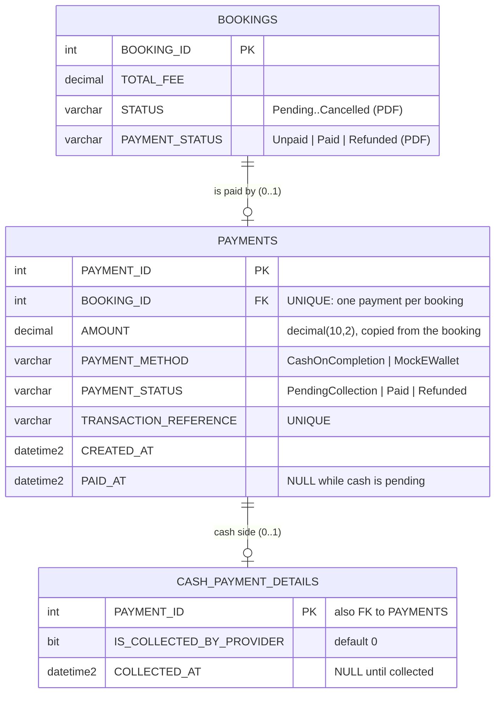

# Approve & Pay: Cash on Completion or Mock E-Wallet

Demo payments only: no money moves and no real GCash or Maya account is called.

## What the customer sees
On the dashboard (Quotation step) and on My Bookings, **Approve & Pay** opens a window with two choices:

| Choice | What is saved | Booking `PAYMENT_STATUS` | Meter |
|---|---|---|---|
| **Cash on Service Completion** | `PAYMENTS` row: `CashOnCompletion`, `PendingCollection`, ref `CASH-2026-0042`, `PAID_AT` empty; plus a `CASH_PAYMENT_DETAILS` row (`IS_COLLECTED_BY_PROVIDER = 0`) | stays **Unpaid** (no money yet) | Paid / **Scheduled** |
| **Mock E-Wallet (GCash / Maya test)** | `PAYMENTS` row: `MockEWallet`, `Paid`, ref `GCASH-48213907` / `MAYA-…`, `PAID_AT` = now | **Paid** | Paid / **Scheduled** |

Both choices push a SignalR `bookingChanged` message, so the customer's and the provider's open pages redraw at once.

## What the provider sees
- Booking Requests cards show the payment line: "Cash on completion — collect ₱650…", "Paid via GCash (test)…", and so on.
- Once a cash job is **Completed**, the card shows **Confirm Cash Received**. Pressing it:
  - sets `IS_COLLECTED_BY_PROVIDER = 1` and `COLLECTED_AT` = now;
  - sets the payment to `Paid` with `PAID_AT` = now;
  - sets the booking's `PAYMENT_STATUS` to `Paid`;
  - notifies the customer and pushes a live update.
- The provider dashboard's "Need Your Attention" list adds "Collect ₱650 cash: …" with a **Confirm Cash** link.
- On Admin › Bookings, the payment column shows **Cash due** until the cash is confirmed.
- The monthly report counts cash revenue only once it is confirmed, because only then is the booking Paid.

## ERD (new entities)

Check constraints:
- `CK_PAYMENTS_METHOD` and `CK_PAYMENTS_STATUS`: only the listed values are allowed.
- `CK_PAYMENTS_AMOUNT`: the amount is 0 or more.
- `CK_PAYMENTS_PENDING_CASH`: only cash can be `PendingCollection`.
- `CK_PAYMENTS_PAID_AT`: a paid or refunded payment has a `PAID_AT`.
- `CK_CASH_COLLECTED`: `COLLECTED_AT` is set if and only if the cash is collected.

`docs/sql/payments-tables-readable.sql` shows the same tables as plain SQL, for reading only. The EF migration `AddPayments` is what creates them.

## Rules and where they are enforced

| Rule | Where |
|---|---|
| Only the signed-in, Active customer who owns the booking can pay. Another customer's booking looks "not found". | `BookingPaymentService.ApproveAndPayAsync` (customer id taken from the sign-in cookie) |
| Pay only an **Accepted** booking that has no payment yet | same, plus the unique index on `PAYMENTS.BOOKING_ID` |
| The amount always comes from the booking, never from the browser | same |
| Only `CashOnCompletion` or `MockEWallet`; wallet must be GCash or Maya; the mobile number must be `09XXXXXXXXX` or `+639XXXXXXXXX` | same (the window checks first for a quick message, but the server decides) |
| A test reference from the window is kept only if it is `GCASH-`/`MAYA-` + 8 digits, matches the chosen wallet and was never used; otherwise the server makes a new one | `WalletReferenceAsync` + unique index on `TRANSACTION_REFERENCE` |
| Two pay requests at the same moment (two tabs, double click): only one wins | the booking's row-version concurrency token and the unique `BOOKING_ID` index; the loser gets "already paid" or "try again" |
| The provider can **Mark In Progress** once the customer paid or chose cash | `ProviderBookingsService.ChangeStatusAsync` (+ `BookingActionInfo.ForBooking`) |
| Only the assigned, Active, Approved provider can confirm cash, only for a **Completed** cash booking, and only once | `BookingPaymentService.ConfirmCashReceivedAsync` |

The mobile number is checked but **not saved**: it is a test number, and storing it would only keep personal data for no reason.

## Bookings paid before this change
Bookings marked Paid by the earlier one-step demo payment have no `PAYMENTS` row. They still show as "Paid", because the code reads `BOOKINGS.PAYMENT_STATUS` first. Nothing needs to be fixed in the data.

## Not included (ask if needed)
- Refunds: the `Refunded` value is allowed by the tables, but there is no refund button. A customer can only cancel a Pending booking, so a paid booking cannot be cancelled today.
- A real GCash or Maya gateway (it would need a merchant account, API keys and webhooks).
